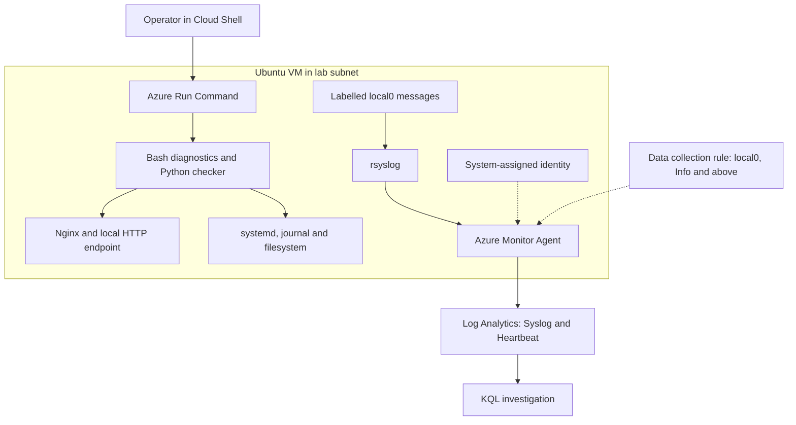
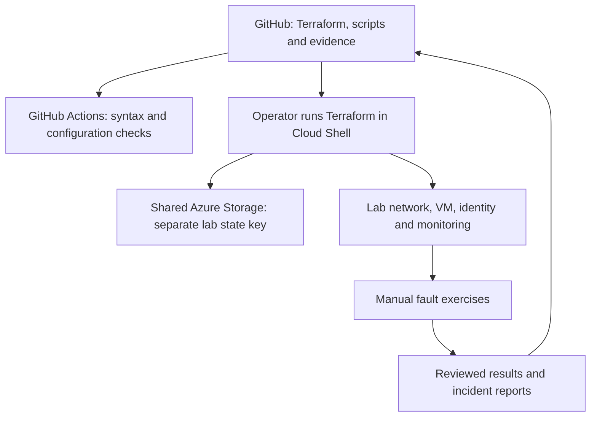

# AI-Assisted Azure Operations & Incident Lab

[Portfolio home](https://github.com/olumideakinseye77-glitch/it-cloud-portfolio) · [All Azure projects](https://github.com/olumideakinseye77-glitch/it-cloud-portfolio/tree/main/azure-projects)

## Purpose

I built this Azure Cloud Engineering learning lab to challenge myself with Linux troubleshooting, Python automation and evidence-based incident investigation. Building on my deployment projects, I wanted to practise explaining why a service failed and verifying its recovery.

## Status

**Core portfolio lab complete. Live deployment offline.** Exercises and monitoring were validated on 18–19 October 2026. A Terraform plan reported no changes before cleanup, and GitHub Actions validation passed.

On 19 October 2026, Terraform destroyed all 12 tracked resources. Azure returned `false` for the existence of `rg-olu-operations-lab`. The code and recorded evidence remain available here for review. Shared Terraform state storage was retained and can still incur storage charges. The diagrams below describe the tested deployment, not currently running resources.

## Architecture

An Ubuntu 24.04 VM runs Nginx in UK South. Terraform manages its network, security group, VM, managed identity and monitoring resources using separate remote state in shared Azure Storage. No public inbound access rule is configured; exercises use Azure Run Command and local HTTP checks.

Azure Monitor Agent authenticates with the VM's system-assigned identity. A data collection rule routes local0 syslog messages at Info severity and above to Log Analytics. Agent heartbeat and two labelled syslog messages were verified with KQL.

### Runtime and investigation

Nginx log collection is not shown as an ingestion path because it was not configured. The verified Syslog records were deliberately labelled test messages. The Python tool ran on demand through Run Command.

### Infrastructure and validation

GitHub Actions did not deploy the lab. Terraform applies and incident actions were initiated manually.

## Design choices and alternatives

These choices served the learning goals; they are not claims that one service is best for every workload.

| Choice | Why I used it here | Alternative and trade-off |
|---|---|---|
| Azure VM with Ubuntu | I wanted direct practice with Linux services, configuration, journals and filesystems. | App Service or Container Apps would suit a managed application-hosting exercise, but would change the amount of host administration I could practise. |
| Nginx | A small service gave me a clear local HTTP success/failure signal and configuration-validation command. | A custom Python application would add application-code troubleshooting; that was outside the first service exercises. |
| Azure Run Command | I could run diagnostics through Azure management access without opening inbound SSH. | SSH would provide an interactive terminal but require a reachable access path and management of the private key. Run Command has latency and is privileged; its permissions need care. |
| Terraform | I could review plans, track resources in state, detect drift and remove the lab predictably. | Portal or CLI steps are useful for exploration, but require additional work to record and repeat consistently. Nginx installation remained a separate script. |
| Shared remote state, separate key | Cloud Shell resets did not erase the infrastructure state. | Local state would need durable storage and backups. Shared storage also creates a dependency that must not be deleted during one lab's cleanup. |
| Bash | It fits Linux command orchestration and service/configuration checks. | Python is more suitable here for structured JSON output and explicit HTTP error handling; I used both for different tasks. |
| Managed identity for the agent | The monitoring agent could authenticate without me storing a client secret in the scripts. | A secret-based identity introduces credential storage and rotation work. Managed identity still requires appropriate configuration and access control. |
| Log Analytics and KQL | I could verify messages centrally and filter them by time, machine, facility and text. | Local journal inspection is useful during diagnosis, but the VM must remain accessible and its local logs available. Central ingestion adds configuration, delay and potential costs. |
| Narrow local0 collection | It let me verify a small, deliberately identifiable data flow. | Broader collection could capture more useful incidents but adds noise and ingestion volume. Nginx log ingestion remains future work. |
| Isolated tmpfs pressure | It demonstrated capacity checks and recovery without filling the root filesystem. | Persistent-disk pressure would be more representative of some incidents, but needs a separately scoped test and recovery plan. |
| Human-reviewed AI assistance | I could compare suggestions against actual command output before deciding what to run. | An automated AI remediation service would need a separate design for permissions, validation, auditing and rollback; none was deployed here. |
| Destroy after testing | The live demonstration was no longer needed once evidence was saved. | Keeping it running supports immediate demos but continues consuming credit or incurring charges. |

## Interview walkthrough

### 1. Establish the infrastructure

I checked regional SKU restrictions, family quota and pricing before deploying. Several older sizes were restricted or lacked quota. I selected D2s_v6 without specifying a zone after finding only a zone-3 restriction and spare family quota. Successful deployment confirmed this attempt; it does not guarantee future capacity.

Terraform created the network, subnet, security group, public IP, network interface and Ubuntu VM. The public IP supported the lab network design, but no public inbound allow rule was added. A future design could review whether a public IP is needed at all and how outbound access should work.

### 2. Establish a healthy baseline

I installed Nginx using the saved Bash script, confirmed active service status and checked HTTP 200 on loopback. Diagnostics also checked configuration syntax, root disk usage and recent service logs. This gave me evidence to compare against a fault.

### 3. Stop, investigate and recover a service

I deliberately stopped Nginx. Diagnostics showed inactive service status and connection refused, while configuration validation still passed and root disk usage remained 8%. I restarted the service and verified both active status and HTTP 200. This separated VM health from application-service health.

### 4. Build and validate a Python check

The Python script combines systemd status with a local HTTP request and emits timestamped JSON. The healthy case returned true with HTTP 200; the stopped-service case returned false, recorded connection refused and exited with code 1. This provides a signal that a future scheduler or pipeline could consume, but no scheduler was implemented.

### 5. Test configuration and filesystem faults safely

I introduced an unknown Nginx directive into a dedicated test file, ran validation and removed the file. I did not reload the bad configuration. A final configuration check and local HTTP request passed.

For capacity pressure, I created a 32 MB tmpfs and wrote 29 MB into it. Usage rose to 91%, producing a console threshold message. Removing the file returned usage to 0%, while root disk usage stayed at 8%. This was a capacity simulation, not a persistent disk outage or Azure alert.

### 6. Verify central monitoring independently

I added the VM identity, Azure Monitor Agent, workspace, collection rule and VM association in Terraform. I first verified agent heartbeat, then separately verified actual Syslog records using KQL. Heartbeat alone was insufficient evidence of message ingestion. Two retry messages appeared in the later query; I did not establish the precise delay.

### 7. Validate, document and clean up

GitHub Actions passed syntax/configuration checks, and the final live Terraform plan showed no drift. I saved incident reports, monitoring evidence and the AI-assistance limitations. I then destroyed 12 lab resources and checked that the project resource group was absent. The separate shared backend was preserved.

### How I would summarise it

“I deployed an Ubuntu incident lab with Terraform, used Bash and Python to diagnose deliberately introduced faults, verified recovery with service and HTTP checks, and confirmed selected logs reached Azure Monitor using KQL. AI helped interpret evidence, while I reviewed and ran the commands. I documented the limits and removed the deployment to control costs.”

## Completed exercises and evidence

| Exercise | Observed result | Evidence |
|---|---|---|
| Stopped web service | Inactive Nginx and connection refused; restart restored active status and HTTP 200 | [Incident 001](incidents/001-stopped-web-service.md) |
| Invalid configuration | Unknown directive rejected before reload; cleanup restored valid configuration; final HTTP 200 | [Exercise 002](incidents/002-invalid-configuration.md) |
| Filesystem pressure | Isolated 32 MB tmpfs reached 91%, then returned to 0%; root usage stayed at 8% | [Exercise 003](incidents/003-disk-pressure.md) |
| Python health checker | Healthy service returned true; stopped service returned false and exit code 1 | [Python validation](docs/python-check-validation.md) |
| Central monitoring | Heartbeat and two local0/info test records queried successfully | [Monitoring validation](docs/monitoring-validation.md) |

## Code and queries

- [Nginx installation](scripts/bash/install-web.sh)
- [Bash diagnostics](scripts/bash/diagnose-web.sh)
- [Python JSON health checker](scripts/python/check_web.py)
- [KQL test-message query](queries/syslog-test.kql)
- [Terraform configuration](terraform)
- [GitHub Actions validation](.github/workflows/ci.yml)

The workflow checks Python syntax, Bash syntax, Terraform formatting and backend-free Terraform validation. It does not deploy Azure resources or run live incident tests. The Python checker was tested separately inside the VM against healthy and stopped-service conditions.

## AI assistance and human review

ChatGPT helped interpret the displayed evidence and suggest commands. I ran the commands and checked results against the expected behaviour. This is interactive AI assistance, not an API integration or autonomous remediation system. See [analysis and limitations](docs/ai-assisted-analysis.md).

## Rebuild outline

1. Clone this repository and authenticate Azure CLI to the intended subscription and tenant.
2. Provide a public SSH key at `~/.ssh/olu-operations-lab.pub`; keep its private key secure and outside Git. For an existing deployment, recover its deployed public key from Azure rather than generating a replacement blindly.
3. Confirm the backend storage account and container exist and that the account has state access. The backend uses a separate `operations-incident-lab.tfstate` key in shared storage.
4. Set `TF_VAR_subscription_id`, run Terraform initialization, review a saved plan, then apply it. VM SKU availability and quota must be rechecked for a new deployment.
5. Run the installation script inside the VM using Azure Run Command. Terraform does not install Nginx or copy the diagnostic scripts automatically.
6. Run the exercises inside the VM, review results and publish sanitised evidence. Send labelled local0 messages and verify ingestion using KQL.

This outline documents the dependencies; a complete destroy-and-rebuild test has not yet been performed.

## Troubleshooting lessons

- SKU restrictions and family vCPU quota are separate deployment checks. Zone-specific restrictions must be distinguished from regional restrictions.
- Cloud Shell files and authentication can disappear between sessions. Pushed Git commits and remote state enabled recovery.
- Configuration validation and running service health are separate checks.
- A healthy agent heartbeat did not initially prove syslog ingestion. A later query found the test messages without forwarding changes; the precise ingestion delay was not established.
- A storage-token timeout blocked Terraform initialization until tenant-specific device authentication was renewed.

## Scope and limitations

- Deliberate faults had known causes; these tests do not demonstrate diagnosis of unknown production incidents.
- HTTP checks were local to the VM. Public availability and continuous uptime were not tested.
- Disk pressure used RAM-backed tmpfs, not a full persistent disk or application write failure.
- The DCR collects selected local0 messages; automatic Nginx access/error log collection and health-check scheduling are not configured.
- No Azure incident alert or notification delivery is configured.
- AI suggestions require human verification; AI accuracy was not benchmarked.

## Cost control

The VM, managed disk, public IP and Log Analytics can incur charges while deployed. Deallocating the VM alone leaves other billable resources. The workspace daily ingestion cap is not a guaranteed spending limit.

For full lab cleanup, review a Terraform destroy plan and apply it, then verify the project resource group is absent. Preserve the separate shared state storage used by other projects. Previously incurred charges remain payable.

## What I want to learn next

I want to strengthen this lab with scheduled health checks, incident alerts and more robust automated tests. My next planned challenge is an Enterprise Landing Zone and Self-Service Cloud Platform, where I intend to practise reusable Terraform modules, governance and controlled deployments.
